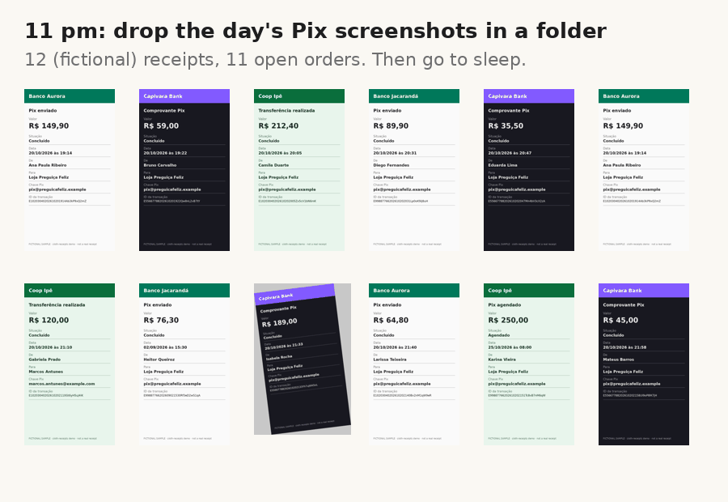

# 🦥 sloth-receipts

**Check the day's Pix payment screenshots against your orders while you sleep, on your own laptop, with Gemma 4 (open weights, local via Ollama).**

The project lives in the [`sloth-receipts/`](sloth-receipts/) folder. Full documentation, results and limits: [sloth-receipts/README.md](sloth-receipts/README.md).

Quick start:

    cd sloth-receipts
    ollama pull gemma4:e2b
    python samples/make_samples.py
    python sloth.py --inbox samples/inbox --orders samples/orders.csv --store-name "Loja Preguiça Feliz" --store-key pix@preguicafeliz.example --out out
    python eval.py out

On 12 fictional receipts (2 vCPU, no GPU): 12/12 verdicts correct, 52 s per receipt.

Write-up: [Gemma 4 checks my Pix receipts while I sleep](https://dev.to/rafaorlando3/gemma-4-checks-my-pix-receipts-while-i-sleep-12-of-12-verdicts-right-even-when-it-misreads-44jn)

MIT License.
